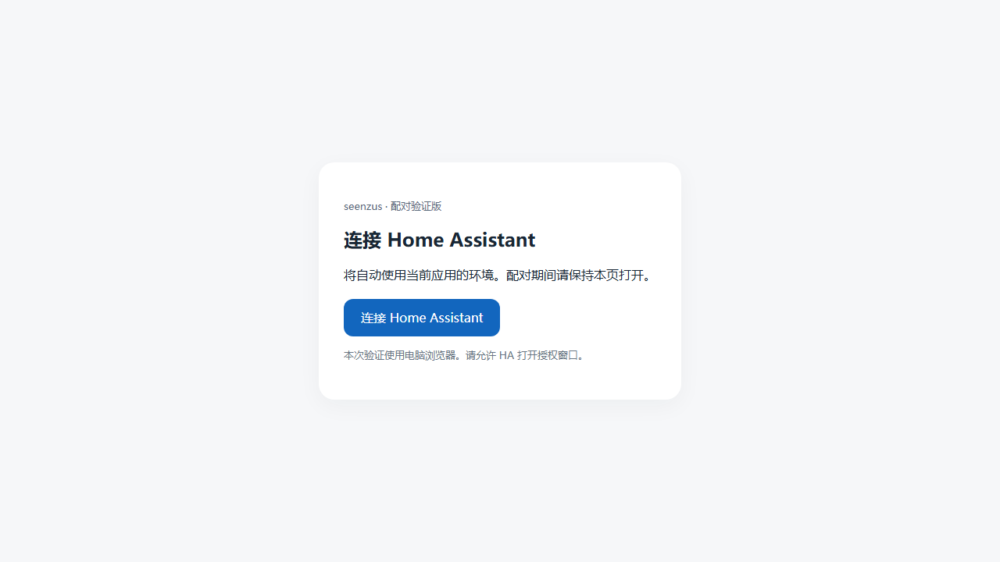

# 应用来源自动配对验证版 · 0.2.16b1

本版用于验证「从哪个应用发起，就回哪个环境授权」，无需选择环境、填写 HA 地址或输入引导码。当前交付为电脑浏览器验证版，包含 #77 基线 `b1cc89318d1a997a21603ba542a5d097dc38c33c` 的多环境及设备范围功能。#77 保持未合并。

## 安装和开始验证

1. 在 HA 中创建完整备份，并额外保存当前 `custom_components/seenzus_bridge` 文件夹。
2. 将本次 ZIP 中的 `custom_components/seenzus_bridge` 整个文件夹覆盖到 HA 配置目录下的同名位置，包含 `translations`。不要嵌套成两层 `seenzus_bridge`。
3. 完整重启 HA，强制刷新 HA 页面。版本应为 `0.2.16b1`。
4. 先在电脑浏览器登录 [UAT 应用](https://uat.seenzus.ai)，再在同一浏览器打开 [UAT 来源配对验证入口](https://uat.seenzus.ai/ha-connect-direct)。

   

5. 点击「连接 Home Assistant」，保持这个入口页打开。按 My Home Assistant 的提示打开自己的 HA；若浏览器阻止弹窗，请允许此入口及 HA 打开弹窗。
6. 在 HA 保持默认「快速配对（自动识别环境）」并继续，选择全部设备或指定设备范围。
7. 应直接进入 `https://uat.seenzus.ai/pair/...` 或 `/pair?session_id=...` 授权；整个应用侧配对链路不应访问 `app.seenzus.cn`。授权后应返回 HA 完成创建。
8. 在 HA 查看条目的环境为 UAT；在 UAT 应用确认对应数据源在线。指定范围时，检查只有授权设备/实体可见。

**本版必须使用上面的专用测试入口。应用原来的配对按钮仍使用旧链路。手机原生 WebView 尚未接入本次窗口交接。**

## 已有 UAT 条目时

同一环境仍只能有一个条目。若 HA 已经配好了 UAT，本次新增应提示该环境已配置，不应创建第二个条目。这个结果可以验证来源识别与重复保护。

验证完整的首次新增，需要没有 UAT 条目的测试 HA。已有 UAT 条目的「重新配对」会沿用保存的 UAT 地址，可以验证重授权，但不能代替首次来源识别验收。不要为了本轮验证直接删除现有条目。

## 异常和回退

- 关闭发起页、换浏览器或窗口隔离导致上下文丢失时，应显示「无法取得发起应用的信息」，不能自行切到国内或境外环境。
- 需要重试时，先在 HA 取消本次流程，关闭该 HA 标签页，再从验证入口发起。
- 若从 HA 直接添加而没有应用发起页，使用「快速配对（手动选择环境）」。
- 回退插件时恢复原插件目录并重启。该验证版包含 #77 的条目版本 2；要回退到不支持版本 2 的旧正式版，应恢复安装前的完整 HA 备份。
- UAT 验证入口是独立路径 `/ha-connect-direct`，由单独的静态容器提供。正式 UAT 首页和 API 继续由原应用处理。验证结束后停止该预览容器即可撤下入口。

## 已验证和待验收

| 范围 | 结果 |
| --- | --- |
| HA Core 2025.1.4 / Python 3.13 | 642 项测试通过 |
| HA Core 2026.10.2 / Python 3.14 | 642 项测试通过 |
| Chromium 窗口通信、跨源隔离与 CSP | 7 项通过；覆盖三个环境、发起页关闭、COOP 阻断、旧流程和重复环境 |
| 真实 UAT 静态入口 + 真实 My Home Assistant 跳转 | 1 项通过；HA 页、交接上下文和授权目的页采用测试夹具 |
| 用户实际 HA 首次添加、真实授权、MQTT 上线及设备范围 | 等待用户验收 |
| 手机 Android/iOS/HarmonyOS 原生交接 | 尚未适配，不在本版验收范围 |

测试记录、源代码提交和文件 SHA-256 随安装包保存在 `PACKAGE-MANIFEST.json` 与 `verification/` 中。浏览器夹具证明路由交接行为，不代表真实账号授权已经完成。

## 本地复现

静态入口由 `node tools/direct_pairing_preview/server.cjs` 启动，监听 8788。必须部署到对应应用域名的 `/ha-connect-direct` 路径，页面根据当前域名确认环境；直接双击本地 HTML 不提供自动配对。

使用安装了 HA 依赖的 Python 运行 `tools/direct_pairing_preview/export_browser_fixture.py fixture.json`，再使用已有 Playwright 的 Node 环境运行 `tools/direct_pairing_preview/browser-tests.cjs fixture.json results.json`。可设置 `REAL_MY_HA=1`、`LIVE_ENTRY=1` 验证线上静态入口和真实 My Home Assistant；HA 页面与授权结果仍为测试夹具。
